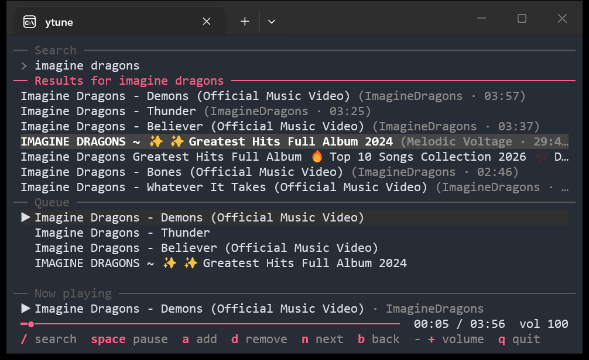

# ytune

A full-screen terminal music player for YouTube. Search, queue songs and control
playback without leaving your terminal.



## Install

You need Windows 10 or 11 (64-bit). You don't need to install Python, Go or anything
else.

1. Download `ytune.exe` from the
   [latest release](https://github.com/jithin-jz/ytune/releases/latest).
2. Double-click it, or run it from a terminal.

The first time it runs, ytune asks to download the programs it depends on, about
126 MB. They go in `%LOCALAPPDATA%\ytune`, and nothing else on your PC is changed.

`ytune.exe` isn't signed, so Windows may show a "Windows protected your PC" warning.
To run it anyway, select **More info**, then **Run anyway**.

To run `ytune` from any folder, move `ytune.exe` to a folder on your `PATH`.

## Usage

```powershell
ytune                     # open the player
ytune imagine dragons     # open and search
ytune https://music.youtube.com/playlist?list=...   # open and queue a link
```

Type in the search box and press `Enter`. You can also paste a video or playlist link
there to add it to the queue.

| Key | Action |
| --- | --- |
| `/` | Go to the search box |
| `Esc` | Leave the search box |
| `Tab` | Move between search, results and queue |
| `Up` / `Down` | Move through a list |
| `Enter` | Play the highlighted song |
| `a` | Add the highlighted result to the queue |
| `d` | Remove the highlighted song from the queue |
| `Space` | Pause or resume |
| `Left` / `Right` | Seek 5 seconds |
| `n` / `b` | Next or previous song |
| `+` / `-` | Volume up or down |
| `q` | Quit |

## How it works

ytune uses [yt-dlp](https://github.com/yt-dlp/yt-dlp) to find songs and download their
audio, then plays the local file through a hidden [mpv](https://mpv.io/) process.
[Deno](https://deno.com/) lets yt-dlp get past YouTube's download checks. The interface
is built with [Bubble Tea](https://github.com/charmbracelet/bubbletea).

Each download is checked against a SHA-256 hash before it's installed, and ytune looks
for a new version of yt-dlp once a day, because YouTube changes often. These programs
aren't part of ytune and keep their own licenses.

YouTube's checks take time, so a song you pick can take 15 seconds or so to start. The
next song in the queue downloads while the current one plays, so it starts straight
away. All audio is deleted when you quit.

## Customizing

Install [Go](https://go.dev/dl/), then clone this repository and change:

- `internal/ui/theme.go` for the colors
- `internal/ui/keys.go` for the keyboard shortcuts

Run `go build` to create your own `ytune.exe`.

## Troubleshooting

If songs stop loading, close ytune and open it again, so that it can check for a new
version of yt-dlp.

If that doesn't help, delete the `%LOCALAPPDATA%\ytune` folder. ytune will download its
programs again the next time it runs.

## Limitations

- Private content such as liked songs and private playlists isn't supported yet, because
  ytune doesn't use your YouTube login.
- Automatic setup only works on Windows. The code also builds for Linux and macOS, where
  you'd install mpv, yt-dlp and Deno or Node.js yourself, but that hasn't been tested.
- Song titles in scripts such as Hindi and Malayalam can look cramped, because of how
  terminals draw them.

## Development

```powershell
go test ./...
```

To test against real YouTube, with the sound off, point `YTUNE_HOME` at a spare folder:

```powershell
$env:YTUNE_HOME = "C:\temp\ytune-test"
go test -tags e2e -run TestEndToEnd -timeout 10m ./internal/ui/
```

## Disclaimer

ytune is an unofficial personal project and isn't affiliated with YouTube or Google. Use
it in line with YouTube's Terms of Service and the laws where you live.

## License

[MIT](LICENSE)
