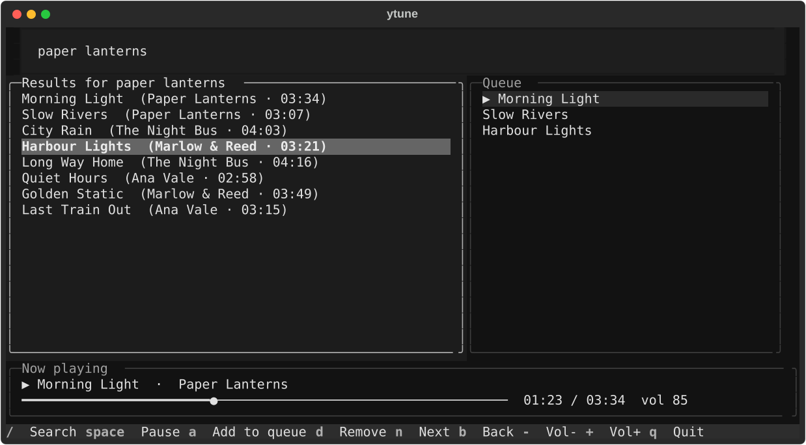

# ytune

A full-screen terminal music player for YouTube. Search, queue songs and control
playback without leaving your terminal.



## Requirements

- Python 3.10 or newer
- [mpv](https://mpv.io/installation/), which plays the audio
- [Node.js](https://nodejs.org/), [Deno](https://deno.com/) or [Bun](https://bun.sh/),
  which yt-dlp needs to get past YouTube's download checks

On Windows you can install mpv with:

```powershell
winget install mpv-player.mpv-CI.MSVC
```

## Install

```powershell
pip install git+https://github.com/jithin-jz/ytune
```

## Usage

```powershell
ytune                     # open the player
ytune tum hi ho           # open and search
ytune https://music.youtube.com/playlist?list=...   # open and queue a link
```

Type in the search box and press `Enter`. You can also paste a video or playlist
link there to add it to the queue.

| Key | Action |
| --- | --- |
| `/` | Go to the search box |
| `Esc` | Leave the search box |
| `Tab` | Move between search, results and queue |
| `Up` / `Down` | Move through a list |
| `Enter` | Play the highlighted song |
| `a` | Add the highlighted result to the queue |
| `d` | Remove the highlighted song from the queue |
| `Space` | Pause or resume |
| `Left` / `Right` | Seek 5 seconds |
| `n` / `b` | Next or previous song |
| `+` / `-` | Volume up or down |
| `q` | Quit |

## How it works

ytune uses [yt-dlp](https://github.com/yt-dlp/yt-dlp) to find songs and download
their audio, then plays the local file through a headless
[mpv](https://mpv.io/) process. The interface is built with
[Textual](https://github.com/Textualize/textual).

Audio is downloaded rather than streamed because streaming YouTube URLs directly
through mpv can fail with HTTP 403 errors. The next song in the queue downloads
while the current one plays, and all audio is deleted when you quit.

## Troubleshooting

If songs stop loading, update yt-dlp first, because YouTube changes often:

```powershell
pip install -U "yt-dlp[default]"
```

## Limitations

- Private content such as liked songs and private playlists isn't supported yet,
  because ytune doesn't use your YouTube login.
- It's only been tested on Windows. The code includes Linux and macOS support, but
  that hasn't been tried.

## Disclaimer

ytune is an unofficial personal project and isn't affiliated with YouTube or Google.
Use it in line with YouTube's Terms of Service and the laws where you live.

## License

[MIT](LICENSE)
